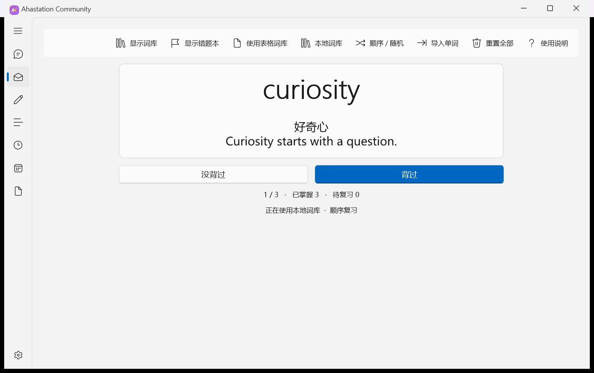
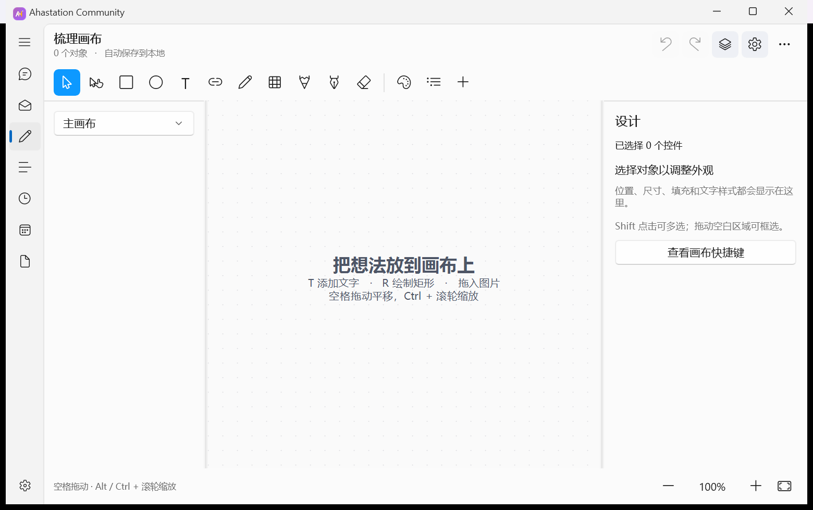
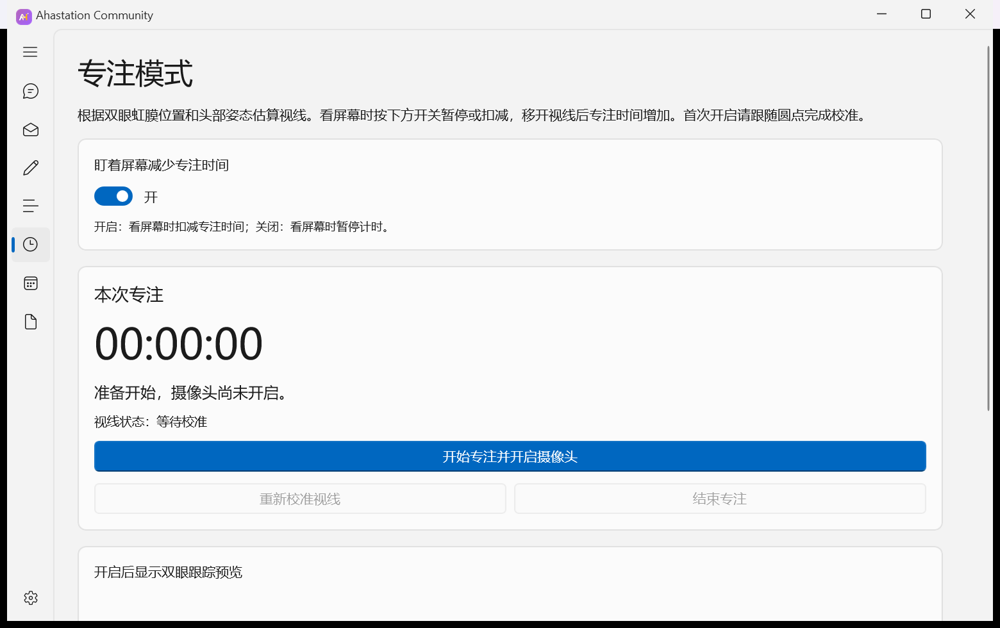

# Ahastation Community

English · [简体中文](README.md)

Ahastation is a Windows study app with a Chinese interface. Review vocabulary with flashcards, revisit missed words, map ideas on a canvas, and keep study notes locally.

## Getting started

1. Download and extract `Ahastation-Community-Windows-x64.zip`.
2. Run `Ahastation.Community.exe` from the extracted folder. Keep the accompanying runtime files alongside the executable.
3. In **单词复习** (flashcards), select **导入单词** to import your word list. To import an XLSX, CSV, or TSV file, open **表格词库** (spreadsheet vocabulary bank).

Use Windows 10 version 2004 (build 19041) or later on x64, or Windows 11 x64. The archive includes the .NET 8 and Windows App SDK runtime files. Camera features in focus mode require Microsoft Edge WebView2 Runtime and camera permission.

## Flashcards

Review meanings, mark a word as learned or missed, and revisit difficult cards. The **艾宾浩斯** page tracks individual spaced-repetition checkpoints.



## Canvas

Arrange text, shapes, pictures, and connectors. Sketch with brushes or the pen tool, adjust layer order and blending modes, add color labels, and export your work as a PNG.



## Focus sessions

Start a focus session and calibrate gaze tracking to measure focused time. Camera-based gaze estimation runs on the device.



## Notes and chat

Use **文本便签** for notes. **聊天** opens DeepSeek chat with conversation history, persona settings, and optional conversation context. Enter your own DeepSeek API key in **设置** (Settings). Sending a message transmits the prompt, persona, and any enabled context to DeepSeek. Usage is billed to your provider account.

## Local storage

The Community edition stores vocabulary, drawings, notes, chat history, and settings under `%LOCALAPPDATA%\AhastationCommunity`. The API key is encrypted for the current Windows user. The screenshots use sample vocabulary.

## Build from source

Install the .NET 8 SDK on Windows x64 and run the following commands from the repository root. The first package restore requires access to NuGet.org.

```powershell
dotnet publish src/Ahastation.csproj -c Release -r win-x64 --self-contained true -o dist
.\dist\Ahastation.Community.exe
```

See the [third-party component notes](src/Assets/Gaze/THIRD_PARTY.md) for the bundled vision runtime and model.
