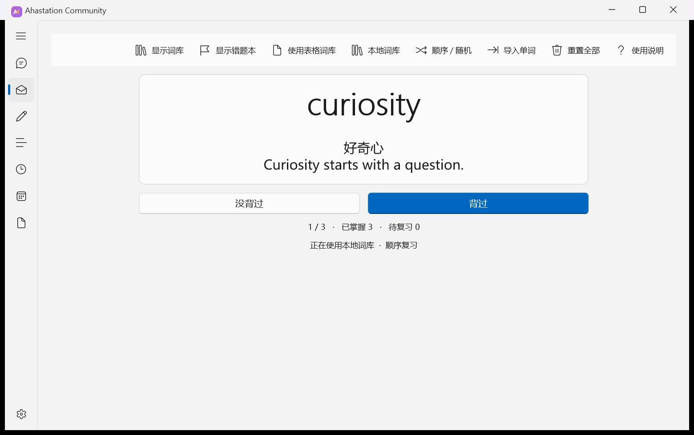
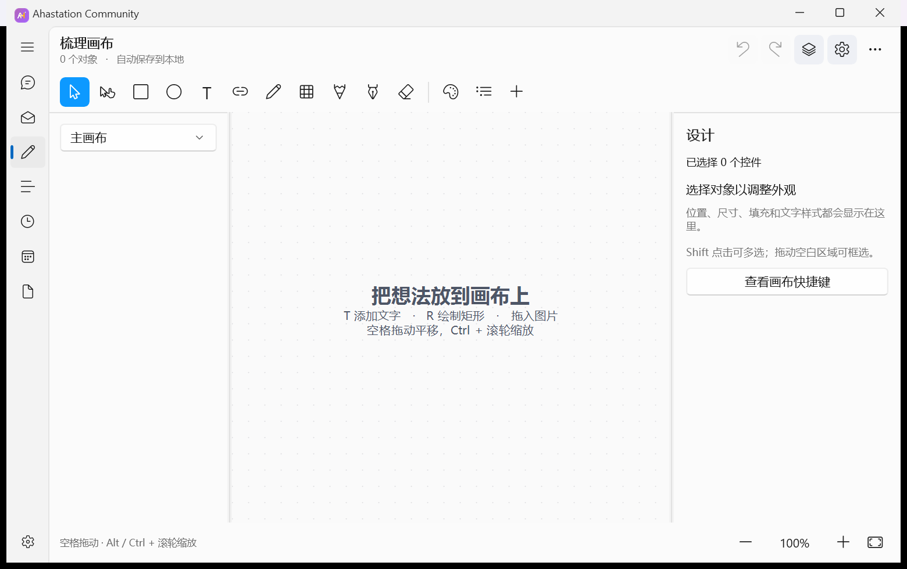
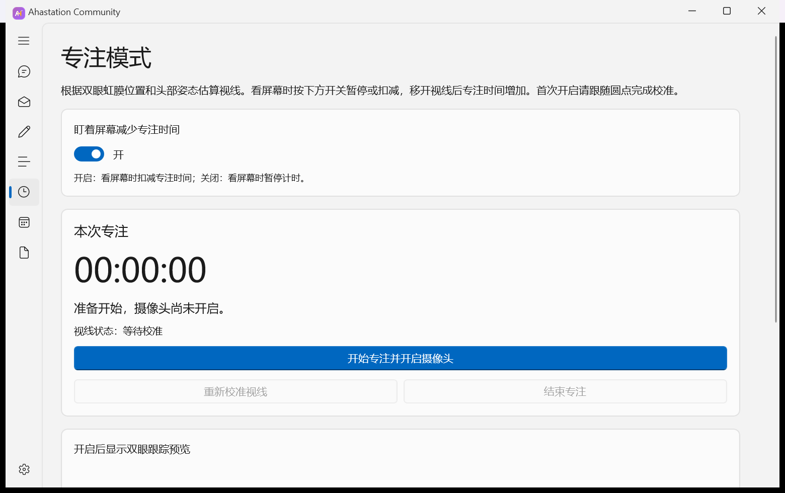

# Ahastation Community

[English](README.en.md) · 简体中文

Ahastation 是一款使用中文界面的 Windows 桌面学习工具。你可以用卡片复习单词，把错词放回练习队列，在画布上梳理知识点，或用便签记录学习内容。

## 开始使用

1. 下载并解压 `Ahastation-Community-Windows-x64.zip`。
2. 打开解压目录，运行 `Ahastation.Community.exe`。程序需要同目录中的运行文件。
3. 首次使用从「单词复习」开始，点击「导入单词」导入自己的词条，也可以在「表格词库」中导入 XLSX、CSV 或 TSV 文件。

支持 Windows 10 版本 2004（内部版本 19041）及以上的 x64 系统、Windows 11 x64。运行包自带 .NET 8 和 Windows App SDK 运行文件。专注模式的摄像头功能使用 Microsoft Edge WebView2 Runtime，需要允许摄像头访问。

## 单词复习

在卡片上复习词义，标记「没背过」或「背过」，用词库和错题本回看需要练习的内容。「艾宾浩斯」页面可以单独记录各个复习节点的完成情况。



## 梳理画布

在画布上摆放文字、图形、图片和连线，使用画笔或钢笔勾勒想法。图层支持调整顺序、混合模式和颜色标签。完成后可以导出 PNG。



## 专注模式

开启专注会话后可以使用摄像头校准视线，记录专注时长。视线识别在本机运行。



## 便签与聊天

「文本便签」用于记录和整理笔记。「聊天」支持 DeepSeek 对话、历史记录、人设设置和可选的上下文记忆。使用聊天前，在「设置」中填写自己的 DeepSeek API 密钥。发送时，消息、人设和启用的上下文会提交给 DeepSeek，由服务商按账户计费。

## 数据存储

公开版将词库、画布、便签、聊天记录和设置保存在 `%LOCALAPPDATA%\AhastationCommunity`。密钥由当前 Windows 用户的凭据加密。截图中的单词为演示数据。

## 从源码构建

在 Windows x64 上安装 .NET 8 SDK 后，从仓库根目录运行下面的命令。首次还原依赖需要访问 NuGet.org。

```powershell
dotnet publish src/Ahastation.csproj -c Release -r win-x64 --self-contained true -o dist
.\dist\Ahastation.Community.exe
```

随包提供的视线识别模型、运行库及上游说明见 [第三方组件](src/Assets/Gaze/THIRD_PARTY.md)。
